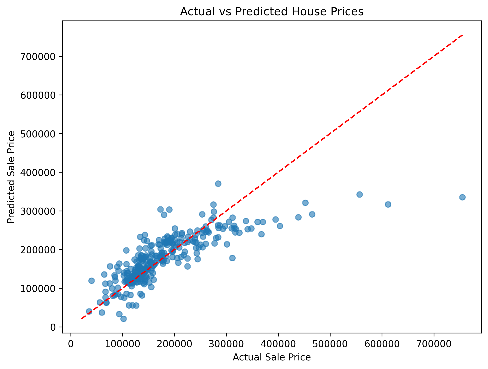
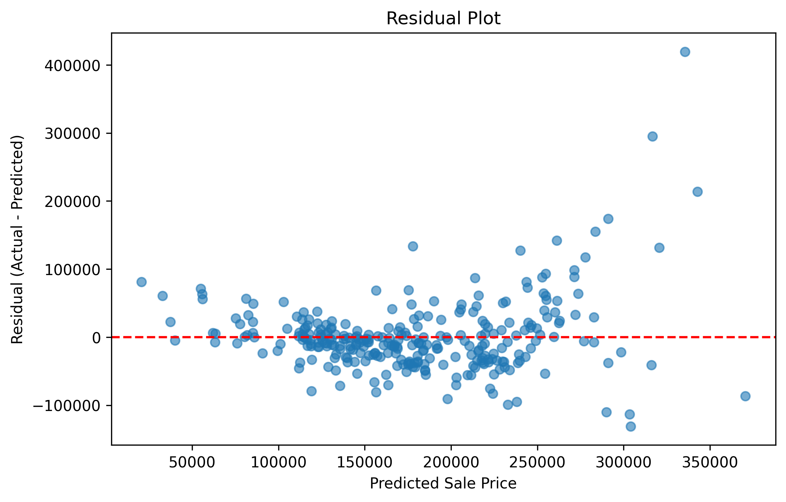

# 🏡 House Price Prediction using Linear Regression

## 📌 Project Overview

This project uses **Linear Regression**, a supervised Machine Learning algorithm, to predict house sale prices based on selected property features.

The project covers data preprocessing, categorical feature encoding, model training, evaluation, visualization, and prediction of missing house prices.

## 🛠️ Tools & Technologies

- **Language:** Python
- **Data Analysis:** Pandas
- **Data Visualization:** Matplotlib
- **Machine Learning:** Scikit-learn
- **Environment:** Jupyter Notebook

## 📂 Project Structure

```text
01-House-Price-Prediction/
├── README.md
├── House_Price_Prediction.ipynb
├── actual_vs_predicted.png
└── residual_plot.png
```

## 🔄 Project Workflow

1. Load and explore the dataset.
2. Separate records with known and missing `SalePrice` values.
3. Encode categorical features using One-Hot Encoding.
4. Split the known-price data into training and testing sets (80:20).
5. Train a Linear Regression model.
6. Evaluate performance using MAE, RMSE, and R².
7. Visualize actual vs. predicted prices and residuals.
8. Predict missing sale prices.

## 📊 Model Performance

The model was evaluated on the test dataset.

| Evaluation Metric | Score |
|---|---:|
| Mean Absolute Error (MAE) | 34,122.85 |
| Root Mean Squared Error (RMSE) | 54,022.75 |
| R² Score | 0.6195 |

### What do these results mean?

- **MAE:** The average absolute prediction error is approximately 34,123 price units.
- **RMSE:** Larger prediction errors have a greater influence on this metric.
- **R² Score:** The model explains approximately 61.95% of the variation in sale prices on the test dataset.

## 📈 Visualizations

### Actual vs. Predicted House Prices

This plot compares actual sale prices with the prices predicted by the model.



### Residual Plot

This plot helps examine prediction errors and identify patterns that may indicate areas for model improvement.



## ⚠️ Limitations

- The model uses a limited set of property features.
- Prediction errors can be substantial, particularly for some higher-priced properties.
- Further feature engineering, missing-value handling improvements, and comparison with other regression algorithms may improve performance.
- Predicted prices are estimates and should not be treated as verified market values.

## 🚀 Future Improvements

- Perform additional exploratory data analysis.
- Improve feature selection and feature engineering.
- Compare Linear Regression with Ridge, Lasso, and Random Forest Regressor.
- Apply cross-validation and further model tuning.
- Explore additional evaluation metrics and error patterns.

## 👨‍💻 Author

**Aayush Anand**

Machine Learning | Python | Data Analytics

---

*This project was completed as part of my Machine Learning learning journey.*
