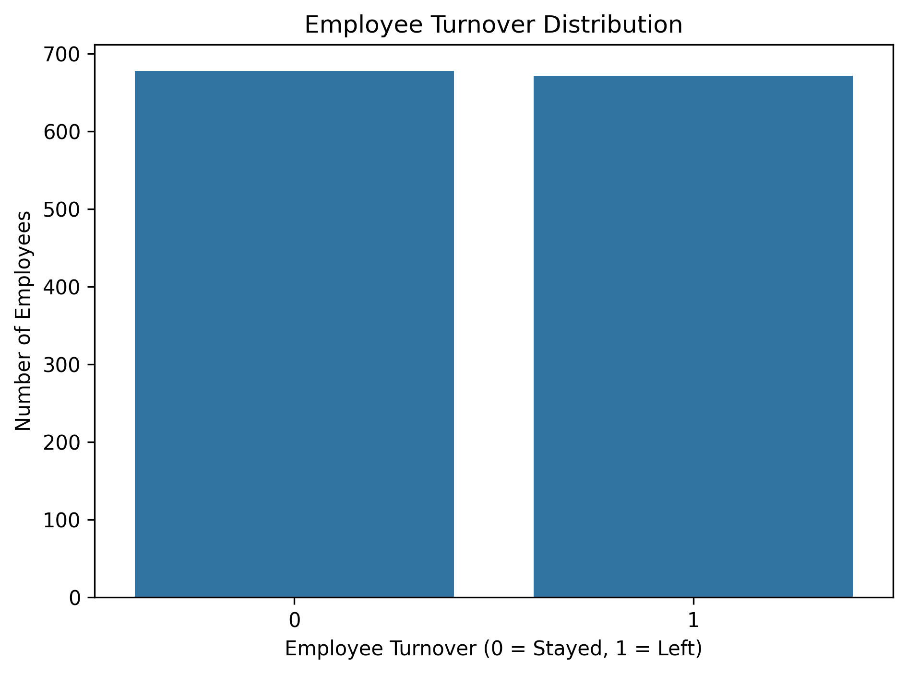
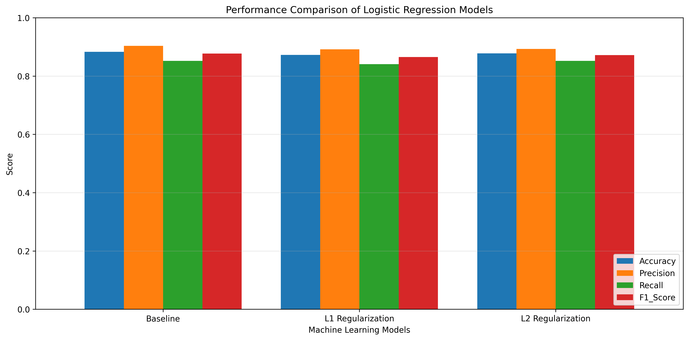
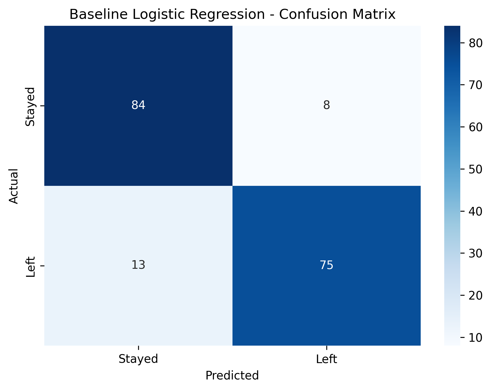
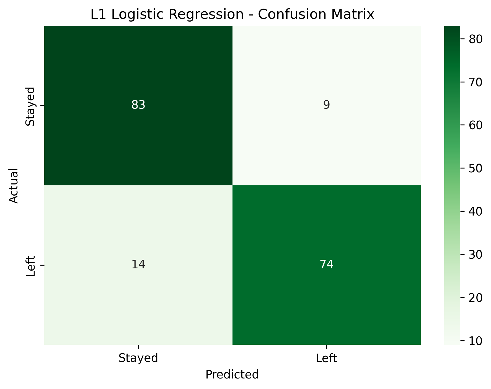
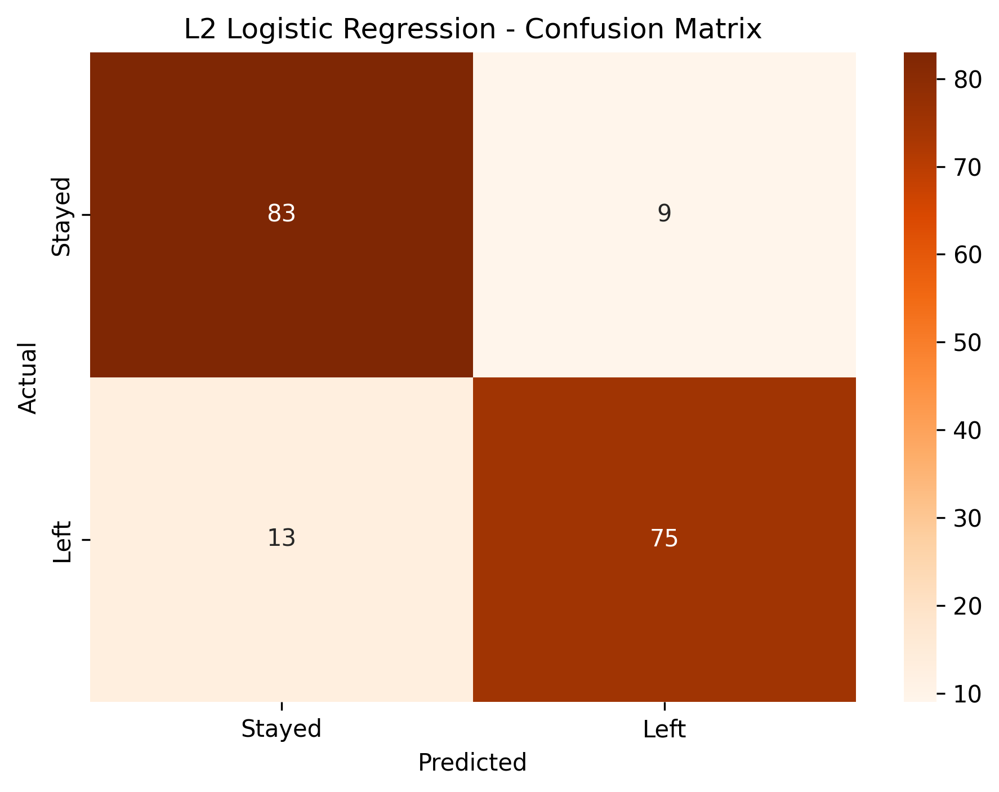

# Employee Turnover Prediction

## Project Overview

This project focuses on predicting employee turnover using Machine Learning. It uses **Logistic Regression** to identify whether an employee is likely to stay with or leave an organization.

The project compares three Logistic Regression approaches:

- Baseline Logistic Regression
- Logistic Regression with L1 Regularization (Lasso)
- Logistic Regression with L2 Regularization (Ridge)

The main objective is to evaluate model performance, understand the impact of regularization, and identify the best-performing model.

## Tools & Technologies

- **Python** – Programming language
- **Pandas** – Data manipulation and analysis
- **NumPy** – Numerical computations
- **Matplotlib** – Data visualization
- **Seaborn** – Statistical visualization
- **Scikit-learn** – Machine Learning and model evaluation
- **Jupyter Notebook** – Development environment

## Project Structure

```text
02-Employee-Turnover-Prediction/
│
├── Employee_Turnover.ipynb
├── employee_turnover.csv
├── requirements.txt
├── README.md
│
└── images/
    ├── .gitkeep
    ├── turnover_distribution.png
    ├── baseline_confusion_matrix.png
    ├── l1_confusion_matrix.png
    ├── l2_confusion_matrix.png
    └── model_comparison.png
```

## Dataset Information

The dataset contains employee-related information used to predict employee turnover.

| Dataset Detail | Value |
|---|---:|
| Initial Records | 1,350 |
| Duplicate Records Removed | 450 |
| Final Records | 900 |
| Input Features | 15 |
| Target Variable | Employee_Turnover |

### Target Variable

The target variable is `Employee_Turnover`.

| Value | Meaning |
|---|---|
| 0 | Employee Stayed |
| 1 | Employee Left |

### Features Used

The dataset includes the following features:

1. Job_Satisfaction
2. Performance_Rating
3. Years_At_Company
4. Work_Life_Balance
5. Distance_From_Home
6. Monthly_Income
7. Education_Level
8. Age
9. Num_Companies_Worked
10. Employee_Role
11. Annual_Bonus
12. Training_Hours
13. Department
14. Annual_Bonus_Squared
15. Annual_Bonus_Training_Hours_Interaction

## Project Workflow

### 1. Data Loading & Exploration

- Loaded the dataset using Pandas.
- Inspected dataset structure, data types, and dimensions.
- Used descriptive statistics to understand feature distributions.
- Examined the target variable distribution.

### 2. Data Cleaning

- Identified duplicate records.
- Removed 450 duplicate records.
- Checked missing values.
- Inspected the cleaned dataset.

### 3. Feature Engineering

- Separated independent variables and the target variable.
- Used the available engineered features, including Annual Bonus Squared and Annual Bonus–Training Hours Interaction.

### 4. Train-Test Split

The dataset was divided into training and testing sets.

- Training Data: 80% (720 records)
- Testing Data: 20% (180 records)
- Random State: 42
- Stratified sampling was used to preserve target class proportions.

### 5. Feature Scaling

Applied `StandardScaler` to standardize numerical features.

The scaler was fitted on the training data and then applied to the testing data to avoid data leakage.

### 6. Model Building

Three Logistic Regression models were implemented.

**Baseline Logistic Regression**

- Used as the reference model.
- No regularization penalty was applied.

**L1 Regularization (Lasso)**

- Uses L1 penalty.
- Can reduce some feature coefficients to zero.
- Helps perform feature selection.

**L2 Regularization (Ridge)**

- Uses L2 penalty.
- Shrinks model coefficients.
- Helps control model complexity.

### 7. Model Evaluation

The models were evaluated using:

- Accuracy
- Precision
- Recall
- F1-Score
- Confusion Matrix
- Classification Report

## Exploratory Data Analysis

### Employee Turnover Distribution

The following chart shows the distribution of employees who stayed and employees who left.



## Model Performance

The following table compares the performance of all three Logistic Regression models on the test dataset.

| Model | Accuracy | Precision | Recall | F1-Score |
|---|---:|---:|---:|---:|
| Baseline Logistic Regression | **88.33%** | **90.36%** | 85.23% | **87.72%** |
| L1 Regularization | 87.22% | 89.16% | 84.09% | 86.55% |
| L2 Regularization | 87.78% | 89.29% | **85.23%** | 87.21% |

### Model Performance Comparison



### Confusion Matrices

**1. Baseline Logistic Regression**



**2. L1 Regularization**



**3. L2 Regularization**



## Best Performing Model

**Baseline Logistic Regression** achieved the highest F1-score of **87.72%** and accuracy of **88.33%** among the three tested configurations.

Therefore, it was selected as the best-performing model in this experiment.

## Key Learnings

Through this project, I gained practical experience in:

- Data cleaning and preprocessing.
- Exploratory Data Analysis.
- Feature engineering.
- Train-test splitting and stratified sampling.
- Feature scaling using StandardScaler.
- Implementing Logistic Regression.
- Understanding L1 and L2 regularization.
- Evaluating classification models using multiple metrics.
- Interpreting confusion matrices and model performance.

## Limitations

- Model performance was evaluated using a single train-test split.
- Hyperparameter tuning and cross-validation were not performed.
- ROC-AUC evaluation was not included.
- The dataset's real-world representativeness has not been independently established.
- The model has not been deployed as a production application.

## Future Improvements

- Apply cross-validation for more reliable model evaluation.
- Perform hyperparameter tuning to improve model performance.
- Evaluate models using ROC-AUC and ROC curves.
- Perform deeper feature importance and coefficient analysis.
- Save the trained model using Joblib.
- Develop an interactive employee turnover prediction application.

## Conclusion

This project demonstrates how Logistic Regression can be applied to an employee turnover classification problem.

By comparing Baseline, L1, and L2 Logistic Regression, the project highlights the impact of regularization on classification performance.

The Baseline Logistic Regression model achieved the best F1-score among the tested configurations.

## Author

**Aayush Anand**

B.Tech – Computer Science & Engineering

GitHub: [aayush8797823674](https://github.com/aayush8797823674)

GitHub Repository: [ML-Projects](https://github.com/aayush8797823674/ML-Projects)
